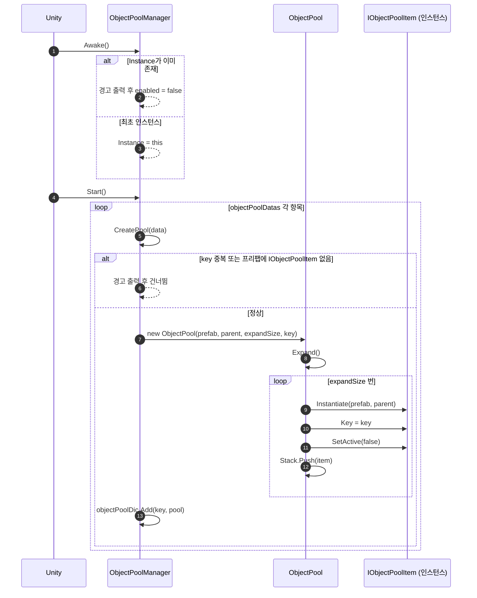
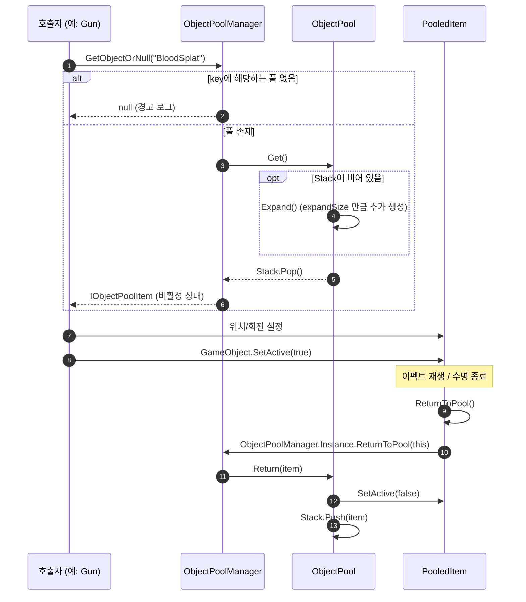
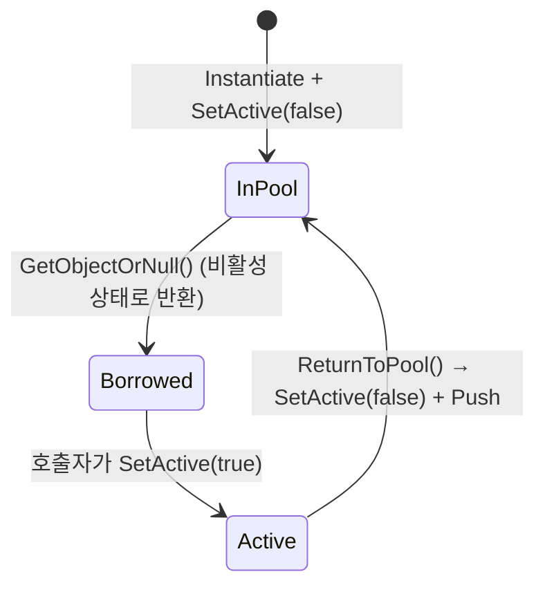

# ObjectPool 기술 문서

> 경로: `Assets/10. Scripts/13. FPS Game/ObjectPool/`
> 네임스페이스: `Study3D.FpsGame`

FPS 게임에서 자주 생성·파괴되는 오브젝트(파티클, 피격 이펙트, 데미지 표시 등)를 **미리 만들어 두고 재사용**하기 위한 오브젝트 풀 시스템입니다. `Instantiate` / `Destroy` 반복으로 생기는 GC 부하와 프레임 드랍을 줄이는 것이 목적입니다.

| 파일 | 역할 |
| --- | --- |
| `IObjectPoolItem.cs` | 풀에 들어갈 오브젝트가 구현해야 하는 인터페이스 |
| `ObjectPoolManager.cs` | 풀 생성·대여·반납을 담당하는 싱글톤 매니저 (내부에 `ObjectPoolData`, `ObjectPool` 중첩 클래스 포함) |

---

## 1. 클래스 관계도

```mermaid
classDiagram
    direction LR

    class MonoBehaviour {
        <<Unity>>
    }

    class IObjectPoolItem {
        <<interface>>
        +string Key
        +GameObject GameObject
        +ReturnToPool() void
    }

    class ObjectPoolManager {
        +ObjectPoolManager Instance$
        -ObjectPoolData[] objectPoolDatas
        -Dictionary~string, ObjectPool~ objectPoolDic
        -Awake() void
        -Start() void
        -OnDestroy() void
        +CreatePool(ObjectPoolData data) void
        +GetObjectOrNull(string key) IObjectPoolItem
        +ReturnToPool(IObjectPoolItem item) void
    }

    class ObjectPoolData {
        <<Serializable>>
        -string key
        -GameObject prefab
        -byte expandSize
        -Transform parent
        +string Key
        +GameObject Prefab
        +byte ExpandSize
        +Transform Parent
    }

    class ObjectPool {
        <<private nested>>
        -Stack~IObjectPoolItem~ pool
        -GameObject prefab
        -Transform parent
        -int expandSize
        -string key
        +ObjectPool(GameObject, Transform, int, string)
        -Expand() void
        +Get() IObjectPoolItem
        +Return(IObjectPoolItem item) void
    }

    class PooledItem {
        <<사용자 구현 예시>>
        +string Key
        +GameObject GameObject
        +ReturnToPool() void
    }

    MonoBehaviour <|-- ObjectPoolManager
    MonoBehaviour <|-- PooledItem
    IObjectPoolItem <|.. PooledItem

    ObjectPoolManager +-- ObjectPoolData : nested
    ObjectPoolManager +-- ObjectPool : nested
    ObjectPoolManager "1" o-- "*" ObjectPoolData : Inspector 설정
    ObjectPoolManager "1" *-- "*" ObjectPool : key별 보관
    ObjectPool "1" o-- "*" IObjectPoolItem : Stack 보관
    PooledItem ..> ObjectPoolManager : ReturnToPool()에서 호출
```

### 구조 요약

- **`ObjectPoolManager`** 는 씬에 하나만 존재하는 싱글톤이며, `key → ObjectPool` 딕셔너리를 가집니다.
- **`ObjectPoolData`** 는 인스펙터에서 풀 하나를 정의하는 설정 데이터입니다.
- **`ObjectPool`** 은 외부에 노출되지 않는 내부 클래스로, 프리팹 하나에 대한 `Stack<IObjectPoolItem>` 을 관리합니다.
- **`IObjectPoolItem`** 을 구현한 컴포넌트가 붙은 프리팹만 풀로 등록할 수 있습니다.

---

## 2. 동작 흐름

### 2.1 초기화



### 2.2 대여(Get)와 반납(Return)



### 2.3 아이템 상태 변화



---

## 3. 사용법 가이드

### Step 1. 풀 아이템 컴포넌트 작성

프리팹에 붙일 컴포넌트에서 `IObjectPoolItem` 을 구현합니다. `Key` 는 매니저가 생성 시 자동으로 채워 주므로 저장만 하면 됩니다.

```csharp
using UnityEngine;

namespace Study3D.FpsGame
{
    [RequireComponent(typeof(ParticleSystem))]
    public class PooledParticle : MonoBehaviour, IObjectPoolItem
    {
        [SerializeField] private ParticleSystem particle;

        public string Key { get; set; }
        public GameObject GameObject => gameObject;

        private void OnEnable()
        {
            particle.Play();
        }

        private void Update()
        {
            // 재생이 끝나면 풀로 귀환
            if (particle.isPlaying == false) ReturnToPool();
        }

        public void ReturnToPool()
        {
            ObjectPoolManager.Instance.ReturnToPool(this);
        }
    }
}
```

> 파티클의 경우 `ParticleSystem.main.stopAction = ParticleSystemStopAction.Callback` 으로 설정하고
> `OnParticleSystemStopped()` 에서 `ReturnToPool()` 을 호출하면 `Update` 폴링 없이 처리할 수 있습니다.

### Step 2. 씬에 매니저 배치

1. 빈 GameObject 생성 (예: `ObjectPoolManager`)
2. `ObjectPoolManager` 컴포넌트 추가
3. 인스펙터의 **만들 풀 목록** (`objectPoolDatas`)에 항목 추가

| 필드 | 설명 | 비고 |
| --- | --- | --- |
| `Key` | 풀을 식별하는 문자열 | 중복 시 경고 후 무시 |
| `Prefab` | 풀링할 프리팹 | `IObjectPoolItem` 구현 컴포넌트 필수 |
| `Expand Size` | 초기 생성 수 겸 부족할 때 추가 생성 수 | `byte` (0~255), 0이면 1로 보정 |
| `Parent` | 생성된 인스턴스의 부모 Transform | 비우면 매니저 자신의 Transform |

### Step 3. 오브젝트 꺼내 쓰기

```csharp
public class Gun : MonoBehaviour
{
    private const string BloodKey = "BloodSplat";

    private void SpawnHitEffect(RaycastHit hit)
    {
        IObjectPoolItem item = ObjectPoolManager.Instance.GetObjectOrNull(BloodKey);
        if (item == null) return;

        Transform t = item.GameObject.transform;
        t.SetPositionAndRotation(hit.point, Quaternion.LookRotation(hit.normal));
        item.GameObject.SetActive(true); // ⚠ 반환된 오브젝트는 비활성 상태입니다
    }
}
```

### Step 4. 반납하기

아이템 쪽에서 `ReturnToPool()` 을 호출하거나, 외부에서 직접 매니저에 반납합니다.

```csharp
item.ReturnToPool();                                // 아이템 스스로 반납 (권장)
ObjectPoolManager.Instance.ReturnToPool(item);      // 외부에서 직접 반납
```

> ❌ 풀 아이템에 `Destroy()` 를 호출하지 마세요. 스택에 파괴된 참조가 남지는 않지만(대여 중엔 스택 밖에 있음) 해당 인스턴스가 영구 손실됩니다.

---

## 4. API 레퍼런스

### 4.1 `IObjectPoolItem` (interface)

| 멤버 | 시그니처 | 설명 |
| --- | --- | --- |
| `Key` | `string Key { get; set; }` | 소속 풀의 키. 매니저가 인스턴스 생성 시 설정하며, 반납 시 어느 풀로 돌아갈지 결정합니다. |
| `GameObject` | `GameObject GameObject { get; }` | 활성/비활성 제어에 사용할 GameObject. 보통 `=> gameObject` 로 구현합니다. |
| `ReturnToPool` | `void ReturnToPool()` | 자신을 풀로 반납합니다. 일반적으로 `ObjectPoolManager.Instance.ReturnToPool(this)` 를 호출하며, 반납 전 상태 초기화 로직을 추가할 수 있습니다. |

### 4.2 `ObjectPoolManager : MonoBehaviour`

#### 프로퍼티

| 이름 | 타입 | 설명 |
| --- | --- | --- |
| `Instance` (static) | `ObjectPoolManager` | 싱글톤 인스턴스. `Awake` 에서 설정, `OnDestroy` 에서 해제됩니다. `DontDestroyOnLoad` 는 적용되지 않으므로 씬 전환 시 사라집니다. |

#### 메서드

##### `void CreatePool(ObjectPoolData data)`

새 풀을 생성하고 `expandSize` 만큼 인스턴스를 미리 만듭니다.

| 조건 | 결과 |
| --- | --- |
| `data.Key` 가 이미 등록됨 | 경고 로그, 생성 안 함 |
| `data.Prefab` 에 `IObjectPoolItem` 없음 | 경고 로그, 생성 안 함 |
| `data.Parent == null` | 매니저의 `transform` 을 부모로 사용 |

##### `IObjectPoolItem GetObjectOrNull(string key)`

풀에서 아이템 하나를 꺼냅니다.

- **반환값**: 비활성 상태의 `IObjectPoolItem`. 키에 해당하는 풀이 없으면 `null` (경고 로그).
- 풀이 비어 있으면 `expandSize` 만큼 자동 확장 후 반환합니다 (상한 없음).
- 호출자가 직접 `SetActive(true)` 해야 합니다.

##### `void ReturnToPool(IObjectPoolItem item)`

아이템을 `item.Key` 에 해당하는 풀로 반납합니다. 아이템은 `SetActive(false)` 후 스택에 push 됩니다. 풀이 없으면 경고 로그만 출력합니다.

#### Unity 메시지

| 메시지 | 동작 |
| --- | --- |
| `Awake` | 싱글톤 등록. 중복이면 경고 후 `enabled = false` |
| `Start` | `objectPoolDatas` 의 모든 항목으로 `CreatePool` 호출 |
| `OnDestroy` | 자신이 `Instance` 면 `null` 로 해제 |

### 4.3 `ObjectPoolManager.ObjectPoolData` (Serializable, public nested)

| 프로퍼티 | 타입 | 설명 |
| --- | --- | --- |
| `Key` | `string` | 풀 식별 키 |
| `Prefab` | `GameObject` | 풀링할 프리팹 |
| `ExpandSize` | `byte` | 초기/확장 생성 개수 |
| `Parent` | `Transform` | 인스턴스 부모 (null 허용) |

모든 프로퍼티가 읽기 전용이고 생성자가 없으므로 **인스펙터에서만 값을 설정**할 수 있습니다.

### 4.4 `ObjectPoolManager.ObjectPool` (private nested)

외부에서 접근할 수 없는 내부 구현입니다.

| 멤버 | 설명 |
| --- | --- |
| `ObjectPool(prefab, parent, expandSize, key)` | `expandSize` 를 최소 1로 보정하고 즉시 `Expand()` |
| `Expand()` | `expandSize` 개를 `Instantiate` → `Key` 설정 → `Return()` 으로 스택에 적재 |
| `Get()` | 스택이 비면 `Expand()` 후 `Pop()` |
| `Return(item)` | `SetActive(false)` 후 `Push()` |

---

## 5. 주의사항 및 개선 제안

| # | 항목 | 내용 | 제안 |
| --- | --- | --- | --- |
| 1 | 초기화 타이밍 | 풀은 `Start()` 에서 생성되므로 다른 스크립트의 `Awake`/`Start` 에서 `GetObjectOrNull` 을 호출하면 실행 순서에 따라 `null` 이 될 수 있습니다. | 풀 생성을 `Awake` 로 옮기거나 `[DefaultExecutionOrder(-100)]` 지정 |
| 2 | 대여 시 비활성 | `Get()` 은 비활성 오브젝트를 반환합니다. 활성화를 잊으면 아무 것도 보이지 않습니다. | `GetObjectOrNull(key, position, rotation)` 오버로드에서 배치·활성화까지 처리 |
| 3 | 생성 직후 `OnEnable` | `Instantiate` 직후 프리팹이 활성 상태면 `OnEnable` 이 한 번 호출된 뒤 비활성화됩니다. 이펙트가 `OnEnable` 에서 재생되면 초기화 순간 한 번 재생 시도가 일어납니다. | 프리팹을 비활성 상태로 저장하거나, `Instantiate` 전에 처리 |
| 4 | 중복 반납 | 이미 풀에 있는 아이템을 다시 `ReturnToPool` 하면 스택에 중복으로 들어가 같은 오브젝트가 두 번 대여될 수 있습니다. | 아이템에 `IsInPool` 플래그를 두거나 `HashSet` 으로 검사 |
| 5 | 무제한 확장 | 풀 크기 상한이 없어 반납 누락 시 인스턴스가 계속 늘어납니다. | `maxSize` 옵션 추가 |
| 6 | null 검사 | `data.Prefab` / `data.Key` 가 null 이거나 `ReturnToPool(null)` 이면 `NullReferenceException` 이 발생합니다. | 진입부 null 가드 추가 |
| 7 | 런타임 풀 생성 | `ObjectPoolData` 에 생성자/setter 가 없어 코드에서 `CreatePool` 을 호출하기 어렵습니다. | 생성자 추가 또는 `CreatePool(key, prefab, size, parent)` 오버로드 |
| 8 | 미사용 using | `ObjectPoolManager.cs` 의 `using UnityEngine.Serialization;` 은 사용되지 않습니다. | 제거 |

> 참고: Unity 2021 이상이라면 내장 `UnityEngine.Pool.ObjectPool<T>` 도 사용할 수 있습니다. 현재 구현은 키 기반으로 여러 프리팹 풀을 한 곳에서 관리한다는 점이 장점입니다.
